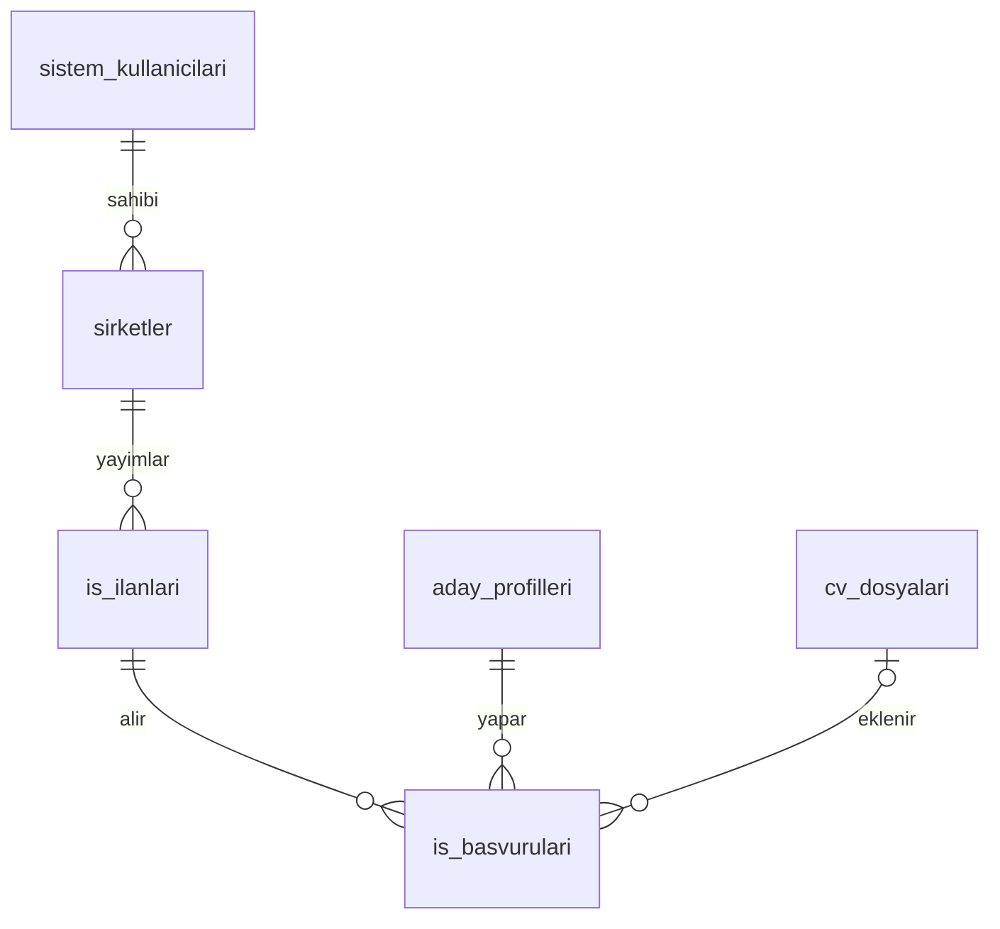

# Şirket, ilan ve başvuru ortak sözleşmesi

Durum: **veritabanı ve .NET API uygulandı; web ve mobil arayüz bağlantısı bekliyor**
Tarih: 2026-11-04
Kapsam: React web, mobil istemci ve .NET API

Bu belge modül 06 ve 07 için ortak sözleşmedir. Canlı veritabanındaki `auth.users`, `sistem_kullanicilari`, `kullanici_roller`, `aday_profilleri` ve `cv_dosyalari` yapısını temel alır. Şirket, ilan ve başvuru tabloları `sql/migrations/20261104_marketplace_core.sql` ile eklendi. Web ve mobil istemciler aynı API biçimini kullanmalıdır.

## Veri modeli



### `sirketler`

| Alan | Tip | Kural |
| --- | --- | --- |
| `id` | uuid | Birincil anahtar |
| `sahip_kullanici_id` | uuid | `sistem_kullanicilari.id`; `isveren` rolündeki sahip |
| `ad` | text | Zorunlu, 2–160 karakter |
| `aciklama` | text | İsteğe bağlı, en çok 2000 karakter |
| `sektor` | text | İsteğe bağlı, en çok 120 karakter |
| `konum` | text | İsteğe bağlı, en çok 150 karakter |
| `web_sitesi` | text | İsteğe bağlı HTTPS adresi |
| `dogrulama_durumu` | text | `beklemede`, `onaylandi`, `reddedildi`; varsayılan `beklemede` |
| `dogrulama_tarihi`, `dogrulayan_id` | timestamptz, uuid | Yönetici kararı sunucuda kaydedilir |
| `is_deleted` | boolean | Varsayılan `false` |
| `olusturma_tarihi`, `guncelleme_tarihi` | timestamptz | Sunucuda tutulur |

Bir işveren ilk sürümde birden fazla şirket oluşturabilir; her şirketin tek sahibi vardır. Şirket açıldıktan sonra yönetici incelemesine girer. Reddedilen şirketin bilgileri sahibi tarafından değiştirildiğinde yeniden `beklemede` olur. Bir şirkete birden fazla işveren hesabı bağlamak gerekirse üyelik tablosu daha sonra gerçek ihtiyaçla eklenir.

### `is_ilanlari`

| Alan | Tip | Kural |
| --- | --- | --- |
| `id` | uuid | Birincil anahtar |
| `sirket_id` | uuid | `sirketler.id` |
| `baslik` | text | Zorunlu, 5–160 karakter |
| `aciklama` | text | Zorunlu, 50–10000 karakter |
| `konum` | text | İsteğe bağlı, en çok 150 karakter |
| `calisma_modeli` | text | `uzaktan`, `hibrit`, `ofis` |
| `istihdam_turu` | text | `tam_zamanli`, `yari_zamanli`, `staj`, `sozlesmeli` |
| `durum` | text | `taslak`, `yayinda`, `kapali`; varsayılan `taslak` |
| `yayin_tarihi`, `son_basvuru_tarihi` | timestamptz | İsteğe bağlı; son tarih yayın tarihinden önce olamaz |
| `is_deleted` | boolean | Varsayılan `false` |
| `olusturma_tarihi`, `guncelleme_tarihi` | timestamptz | Sunucuda tutulur |

İlk sürümde iş ilanı becerileri serbest metin veya JSON alanına gömülmez. İlan eşleştirmesi başladığında katalogdaki `beceriler` ile `ilan_becerileri` ilişkisi eklenir; o aşamaya kadar ilan metni görüntülenir ve aranır. Böylece henüz tanımlanmamış bir ilişkiyi veri tabanında erkenden çoğaltmayız.

### `is_basvurulari`

| Alan | Tip | Kural |
| --- | --- | --- |
| `id` | uuid | Birincil anahtar |
| `ilan_id` | uuid | `is_ilanlari.id` |
| `aday_id` | uuid | `aday_profilleri.id`; oturumdaki aday |
| `cv_dosyasi_id` | uuid | İsteğe bağlı; adaya ait etkin CV |
| `on_yazi` | text | İsteğe bağlı, en çok 3000 karakter |
| `durum` | text | `gonderildi`, `geri_cekildi`; varsayılan `gonderildi` |
| `is_deleted` | boolean | Varsayılan `false` |
| `olusturma_tarihi`, `guncelleme_tarihi` | timestamptz | Sunucuda tutulur |

Bir adayın aynı ilana aynı anda yalnızca bir etkin başvurusu olabilir. Başvuruyu geri çekmek, `durum = geri_cekildi` yapar; geçmiş kaydı korunur. `is_deleted` yalnızca kayıt görünürlüğü için ayrıca kullanılır. CV daha sonra silinse bile başvuruda seçilmiş CV kimliği geçmişte kalır; işverenin eski dosyaya erişimi bu seçimle otomatik olarak açılmaz. İşveren CV erişimi ayrıca tasarlanmalıdır.

## Yetkiler ve veri güvenliği

- `isveren` rolündeki kullanıcı kendi şirketini ve o şirkete bağlı ilanları oluşturur, düzenler, kapatır ve soft delete yapar. Başka şirketin taslağını göremez.
- İşveren, şirketi onaylanmadan ilanını taslak olarak hazırlayabilir; `yayinda` durumuna geçiremez. Bu kural API ve veritabanı tetikleyicisinde uygulanır. `yonetici` rolü inceleme bekleyen şirketleri listeler ve onaylar veya reddeder.
- Giriş yapan herkes yalnızca etkin ve `yayinda` durumundaki ilanları görebilir. Şirket sahibi kendi taslak ve kapalı ilanlarını da görür.
- `aday` rolündeki kullanıcı yalnızca kendi başvurusunu yapar, listeler ve geri çeker. Başvuru sırasında ilan `yayinda`, şirket etkin ve varsa CV adaya ait ve etkin olmalıdır.
- Şirket sahibi yalnızca kendi ilanlarına gelen başvuruların temel bilgilerini görebilir. İlk sürümde adayın tüm profiline veya özel CV dosyasına bu yolla erişim verilmez.
- Bu kurallar .NET servisi yanında Supabase RLS içinde de uygulanır. Mobilin doğrudan Supabase'e bağlanması yetki sınırlarını aşamaz.
- Şirket, ilan ve başvurularda fiziksel `DELETE` yetkisi istemcilere verilmez. Liste sorguları `is_deleted = false` koşulunu kullanır.

## API v1

Korumalı çağrılarda `Authorization: Bearer <Supabase access_token>` kullanılır. Alan adları JSON'da camelCase olur. Başarılı oluşturma `201`, güncelleme `200`, silme veya geri çekme `204` döner. Liste yanıtı ilk sürümde doğrudan dizidir; sayfalama eklendiğinde ayrı sürüm veya geriye uyumlu meta veri sözleşmesi belirlenir.

| İşlem | Metot ve yol | Rol |
| --- | --- | --- |
| Şirketlerim | `GET /api/companies/mine` | İşveren |
| İnceleme bekleyen şirketler | `GET /api/companies/pending` | Yönetici |
| Şirket inceleme kararı | `PATCH /api/companies/{id}/review` (`{"approved":true/false}`) | Yönetici |
| Şirket oluştur | `POST /api/companies` | İşveren |
| Şirket güncelle | `PUT /api/companies/{id}` | Sahip |
| Şirketi arşivle | `DELETE /api/companies/{id}` | Sahip |
| Yayındaki ilanlar | `GET /api/jobs` | Oturumlu kullanıcı |
| İlan ayrıntısı | `GET /api/jobs/{id}` | Yayındaki ilan veya sahibi |
| Şirketimin ilanları | `GET /api/jobs/mine` | İşveren |
| İlan oluştur | `POST /api/jobs` | Şirket sahibi |
| İlan güncelle | `PUT /api/jobs/{id}` | Şirket sahibi |
| İlanı arşivle | `DELETE /api/jobs/{id}` | Şirket sahibi |
| Başvurularım | `GET /api/applications/mine` | Aday |
| İlana başvur | `POST /api/jobs/{id}/applications` | Aday |
| Başvuruyu geri çek | `PATCH /api/applications/{id}/withdraw` | Başvuran aday |
| İlana gelen başvurular | `GET /api/jobs/{id}/applications` | Şirket sahibi |

### Örnekler

Şirket oluşturma isteği:

```json
{"name":"Örnek Teknoloji","description":"Ürün geliştirme ekibi","sector":"Teknoloji","location":"İstanbul","website":"https://example.com"}
```

Şirket yanıtı: `id`, `name`, `description`, `sector`, `location`, `website`, `verificationStatus`, `createdAt`, `updatedAt`.

İlan oluşturma isteği:

```json
{"companyId":"UUID","title":"Backend Geliştirici","description":"Pozisyon ve beklentilerin ayrıntılı açıklaması...","location":"İstanbul","workModel":"hibrit","employmentType":"tam_zamanli","status":"taslak","applicationDeadline":null}
```

İlan yanıtı: `id`, `companyId`, `companyName`, `title`, `description`, `location`, `workModel`, `employmentType`, `status`, `publishedAt`, `applicationDeadline`, `createdAt`, `updatedAt`. `status = yayinda` ilk kez kaydedildiğinde `publishedAt` sunucuda atanır.

Başvuru isteği:

```json
{"cvFileId":"UUID veya null","coverLetter":"Bu pozisyonla ilgileniyorum..."}
```

Başvuru yanıtı: `id`, `jobId`, `candidateId`, `cvFileId`, `coverLetter`, `status`, `createdAt`, `updatedAt`. İşverenin aldığı yanıtta özel CV bağlantısı bulunmaz.

### Hata biçimi

Mevcut API biçimi kullanılır:

```json
{"timestamp":"2026-11-04T12:00:00Z","status":403,"error":"Forbidden","code":"MKT-001","message":"Bu işlem için hesap türünüz uygun değil.","path":"/api/jobs"}
```

Hata durumları: `400` alan doğrulama, `401` eksik/geçersiz oturum, `403` yanlış hesap türü (`MKT-001`), `404` etkin kayıt bulunamadı veya sahiplik yok (`COM-002`, `JOB-002`, `APP-002`), `409` şirket onaylanmadan ilan yayımlama (`COM-004`), aynı ilana etkin başvuru (`APP-001`) veya başvuru kabul etmeyen ilan (`JOB-004`). Veritabanı işlemi başarısız olursa ilgili `*-003` koduyla `502` döner.

## Uygulama sırası

1. SQL migration ile üç tablo, kısıtlar, indeksler ve RLS eklendi. Mevcut kullanıcı veya CV verisi değiştirilmedi.
2. .NET içinde şirket, ilan ve başvuru servisleri ile controller'lar eklendi.
3. Aday ve işveren hesaplarıyla sahiplik, başvuru ve soft delete akışı uçtan uca test edilir.
4. Web ve mobil gerçek API'ye bağlanır. Mock iş ilanı verileri ardından kaldırılır.

## Ayrı karar gerektiren konu

İşverenin başvurudaki CV dosyasını ne zaman ve hangi açık erişim kuralıyla göreceği bu sürümde tanımlı değildir. Özel depolama alanına otomatik erişim açılmaz.
